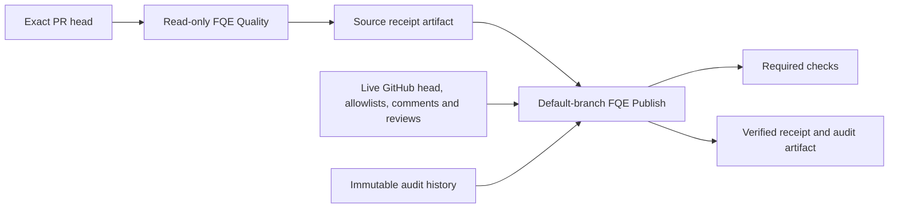

# Architecture

FQE runs declared tools and computes PASS, FLAG or FAIL from their structured evidence. The verdict path is `cli/bin/fqe.js` → `cli/lib/orchestrator.js` → `cli/lib/verdict.js`. Models can propose tests in a separate workflow; no model decides the verdict.

## Local execution

`fqe run` removes prior receipt outputs before loading configuration, hashes the current checkout inputs and diff, selects runners, validates reports, computes the verdict and writes `QA-RESULT.yml` and `QA-RESULT.md`. Missing configured evidence fails at the relevant boundary. A failed run cannot leave a previous PASS receipt for the caller to reuse.

The configuration opts into required runner classes, coverage liveness, money invariants, mutation gates and other checks. Standard `init` enables `require_nonempty_gate`, so its empty scaffold blocks until required runners exist. Legacy configs that omit this flag retain their behavior; inspect their coverage rather than assuming every PASS is meaningful.

The core pieces are:

| Source | Responsibility |
|---|---|
| `config.js`, `classifier.js`, `runner.js` | Validate configuration, choose runners and collect execution evidence |
| `junit.js` | Validate reports and count executed, skipped and failed/error cases |
| `mutation_gate.js` | Preserve mutation counts and apply advisory or blocking thresholds |
| `verdict.js` | Deterministic aggregation; failures and flags cannot be cleared by a later pass |
| `receipt.js`, `signature.js` | Validate and serialize evidence; optionally sign its known scope |
| `ci_guard.js` | Native GitHub authority, source-run binding, current reviews and audit history |
| `bypass_guard.js`, `oracle_guard.js` | Validate bypass comments and classify grading/oracle changes |

The Stryker runner emits a mutation report. Its kill ratio is a deterministic mutation-quality signal; it is not treated as independent trials for a Wilson attack-success interval. Wilson bounds remain available for properly configured adversarial experiments.

## GitHub execution and authority

The evaluation job executes PR code with a read-only token and no persisted checkout credential. The publisher installs a reviewed FQE ref, consumes evidence as data and does not execute PR code. `ci-verify` requires the receipt's commit and source run/attempt to match the completed GitHub run and the currently open PR head. The source workflow must have completed successfully before a clean receipt is accepted.

The publisher resolves bypass identity from GitHub comments and reviewers from GitHub reviews. It reads allowlists at the current default branch. Only the latest non-pending, non-comment review for each account counts; it must approve this head and come from a currently allowlisted account other than the author/requester. Oracle changes always require independent review. A bypass request at a rate over 10% also requires it; ordinary clean PRs do not.

Audit artifacts have immutable names binding publisher run and attempt. History is paginated and checked against server metadata. A latest completed publisher without a record, a conflicting record or incomplete inventory fails closed. The rate counts distinct audited PR heads in 14 days, not unique PRs. No history is unknown; it is never silently presented as zero.

## Evidence limits

Receipts describe what configured runners reported. A source job that controls its own tests can manufacture weak evidence; protected grading rules and independent review are necessary. Optional HMAC signing in the trusted publisher authenticates the validated known fields, including runner evidence, run identity and timestamps. It does not prove that the product works or that the signer has the right organizational authority.

A cached green GitHub check is a point-in-time result. Expiration or access changes need a rerun; they do not automatically invalidate a previously posted check. Publisher bootstrap, branch protection, forks, review events and merge queues need dedicated native acceptance tests. Artifact retention is 90 days by default and is not a compliance guarantee. See [SECURITY.md](../SECURITY.md) for deployment controls and [writing a runner](writing-a-runner.md) for the evidence contract.

The engine self-hosts its spec-mutation, requirement-trace and ledger-reconciliation checks. These checks join the stable required `test` aggregator with unit tests, documented-count validation and packed installation tests.

Publisher signatures attest to validated commit/run binding and current server authority, while recording the source job's runner claims. They do not establish honest runner output: PR code can forge data inside its own evaluation job. Protected grading rules, independent review and meaningful negative controls remain necessary.

Bypass history is read only to authorize a bypass; missing history never cancels a clean ordinary test result. For a bypass request, missing or unsupported audit schemas fail closed. New artifacts use v2 names with the server-bound source head SHA so repeated attempts cannot dilute the rate.
